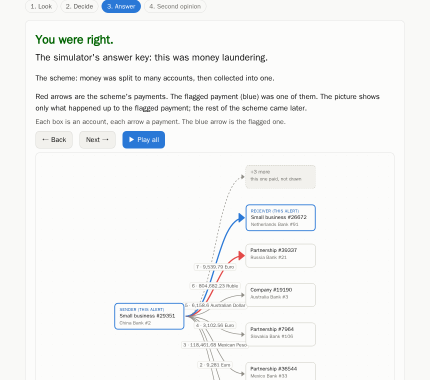
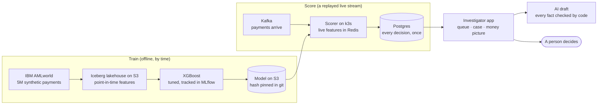
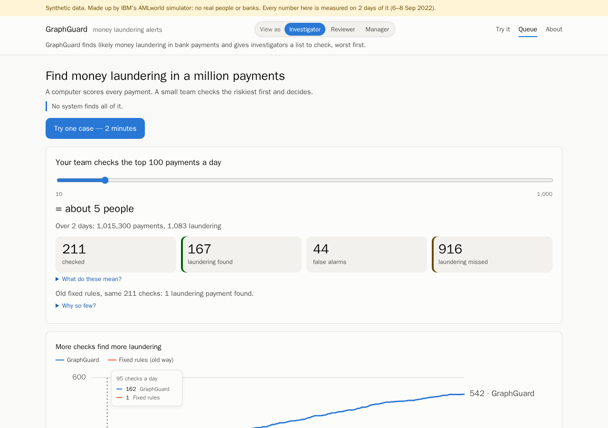

# GraphGuard-AI

**Money laundering hides in the shape money moves in, not in any single payment.**
GraphGuard scores every payment, ranks the riskiest first, and shows an investigator the
money around it, with an AI draft whose every fact is checked by code. The person decides.

### ▶ [Live demo: graphguard.lubobali.com](https://graphguard.lubobali.com) · [Try one case in 2 minutes](https://graphguard.lubobali.com/try/)

> **Synthetic data, said first.** Everything here runs on IBM's AMLworld simulator: no real
> people, no real banks. Every number below is measured on the **validation** window. The test
> window is still sealed, and it gets opened once.

<p align="center">
  
</p>

---

## In 30 seconds

| | |
|---|---|
| **The old way vs this** | A team checking 100 alerts a day (**211** over the 2-day window): the model-led queue finds **167** laundering payments. The old fixed rules, same 211 checks, find **1**. |
| **Whole schemes found** | **127 of 168** laundering rings show up in the top 5,000 alerts (XGBoost, PR-AUC **0.28155**). |
| **The graph neural network lost** | GraphSAGE: PR-AUC **0.04470**, 60 of 168 rings, with the same features and the same tuning budget. Written up as a finding, not tuned away. |
| **Fast enough to sit in a payment flow** | p99 **13-15 ms** per score on Kubernetes (k3s), measured open loop. |
| **Live equals offline** | The whole window, **1,015,300** payments, replayed overnight through Kafka: **0** score mismatches with the offline evaluation. |
| **The AI, measured** | Before checking, **4.0%** (DeepSeek V4.1 Flash) and **5.6%** (Claude Sonnet 5.5) of the AI investigator's claims were unsupported. A code checker drops them, so the page shows 0. |

## How it fits together



<p align="center">
  
</p>

The home page answers a manager's real question: *with this many people, what do we catch and
what do we miss?* It shows the misses (916 of 1,083), because no system finds all of it.

---

## What I'd do differently

- **Put the interface in front of a person sooner.** Serving and the stream were built before
  anyone used the queue. The first outside test (an AI stand-in, see R-6 in `PLAN.md`) found
  confusing words that could have been fixed in week one. A real-person test is still owed.
- **Hold out the AI checker's test set from day one.** The first checker was fixed on the
  same alerts it was judged on. The clean number came from a second set, drawn afterwards
  ([FINDING-019](docs/findings.md)).
- **Skip Ray Serve for one small model.** 94% of the scorer's CPU went to the serving
  framework, not the model ([FINDING-013](docs/findings.md)). The stream now scores in
  process.
- **Check the simulator's artifacts before the first model.** Three features (and later the
  weekday) learned the simulator, not the crime ([FINDING-006](docs/findings.md),
  [FINDING-018](docs/findings.md)).

## Next

| | |
|---|---|
| Phase 8 | monitoring and drift, a retraining pipeline, champion vs challenger, a model-risk card |
| Go-live | the sealed test window, replayed once, as if it were the next days of payments |
| Phase 9 | a second dataset (TransXion), to see what holds outside one simulator |
| Phase 10 | scale toward 180M payments, optional and honest about the box |

---

## The problem

Money laundering does not look suspicious one transaction at a time. It looks
like a **shape**. Here is a real cycle from the data:

```
806D31C80  ──►  80D0D5F80     $14,435
80D0D5F80  ──►  80EB13650     €12,319
80EB13650  ──►  80E0555C0     $15,471
80E0555C0  ──►  806D31C80     $16,587
```

The money leaves an account, passes through three others, and returns. Every
individual hop is an ordinary business transfer for an ordinary amount. Nothing
in any single row is unusual — measured, a ring spans a median of **8 accounts
over 3.1 days**.

**What the system does:** produces a ranked queue of accounts worth
investigating, with a reason attached.

**What it does not do:** decide anything. A human works the queue; the model
decides the order.

---

## Results in full

All on the **validation** window.

| Model | PR-AUC | precision@1000 | Laundering rings caught |
|---|---|---|---|
| random ranking | 0.00107 | 0.000 | 0 / 168 |
| rank by amount | 0.00170 | 0.001 | 0 / 168 |
| MLP, graph disabled | 0.01869 | 0.085 | 34 / 168 |
| GraphSAGE (GNN) | 0.04470 | 0.111 | 60 / 168 |
| **XGBoost** | **0.28155** | **0.332** | **127 / 168** |

At 1,000 alerts, **332 are real laundering**, against roughly 1 for a random queue.

---

## What makes the numbers trustworthy

This is the part most portfolio ML projects skip, and it is the reason the
result above is worth reading.

### The leakage contract, enforced by CI

Five rules, each turned into a build failure rather than a document nobody
rereads:

1. Split by time, never randomly
2. The graph at time T contains only edges before T
3. No feature may use information that did not exist at decision time
4. The test window is opened once
5. A feature that looks too good gets investigated, not celebrated

Three custom guards run in pre-commit hooks and in CI. Each is proven to block a
real commit, not merely to run:

| Guard | Enforces |
|---|---|
| `leakage_guard.py` | feature builders must take a time cutoff; label columns cannot reach feature code |
| `split_integrity_check.py` | the frozen split's checksum cannot change silently |
| `test_set_touch_check.py` | the test window has one approved load site |

The split itself is committed and checksummed:
[`data/splits/frozen_split.json`](data/splits/frozen_split.json).

### Findings that changed the build

Twenty are recorded in [`docs/findings.md`](docs/findings.md). Three early ones that
mattered most:

**The dataset disagrees with its own documentation.** HI-Small is described as
covering Sep 1–10; it actually runs to Sep 18, and those last 8 days are
**57–73% laundering** against 0.1% in the documented period. They are 0.02% of
rows but **12.6% of all positives**. Left in, a temporal split produces a
majority-positive test set and a meaningless precision@k. They are truncated,
and the cost is stated.

**Three features were learning the simulator, not the crime.** `payment_format`
alone carried 45% of the model's gain, because IBM's generator emits **85% of
laundering as ACH and none at all as Wire**. With `is_cross_currency` and
`is_self_transfer`, three artifacts accounted for 65% of the gain. Removed, and
the **lower number is the one quoted**: PR-AUC 0.282 rather than 0.360. Full
feature-by-feature audit in [`docs/leakage_audit.md`](docs/leakage_audit.md).

**The biggest accounts are innocent.** The largest sender makes 168,672
transfers and is labelled a sole proprietorship. Its laundering rate matches the
dataset average. Any feature built on raw degree ranks these first and buries
real cases.

### The graph model lost, and the ablation says why

GraphSAGE reached PR-AUC 0.04470 against XGBoost's 0.28155, on the same
features, the same frozen split, the same `evaluate()` entry point and the same
20-trial Optuna budget.

The ablation is what makes the result attributable. Across the search, 12 trials
ran with message passing enabled and 8 with it disabled:

```
graph on   → best 0.06198,  60/168 rings
graph off  → best 0.01869,  34/168 rings
```

**Graph structure is worth about 3.3× over identical features without it.** The
gap to the tree is a model-class gap on tabular features — consistent with the
literature on gradient-boosted trees versus neural networks — not a failure of
the graph.

The largest single effect was `pos_weight`. Fixed at the exact class ratio of
1326, correct for XGBoost's `scale_pos_weight`, gradient descent was
destabilised and the GNN scored 0.0075. Optuna chose **6.34** and it improved
**8×**. One number, right for one model class and catastrophic for the other,
found only because both models received the same search budget.

Full comparison and caveats: [`docs/model_comparison.md`](docs/model_comparison.md).

---

## The data is synthetic

**IBM AMLworld**, generated by IBM's multi-agent simulator for a NeurIPS paper.
Not real bank data, stated up front rather than buried: no bank can legally
publish labelled laundering rings, which is why every paper in this area uses
this dataset.

```
5,078,345 transactions · 515,080 accounts · Sep 2022
5,177 laundering (0.102%, 1 in 981) · 370 labelled rings
```

It ships labelled pattern files — ground truth rings by type — which is what
makes pattern-level recall measurable at all. Note that **38% of laundering
belongs to no labelled ring**, so ring-level recall is computed over the other
62% and that denominator is reported rather than implied.

---

## Method

**Metric: precision@k, not AUC.** At a 0.1% base rate a model can score 0.99 AUC
and still hand investigators a worthless queue. `k` is investigator capacity —
how many alerts a team can actually work in a day.

**Split: temporal, frozen once.** Earliest 60% of rows trains, next 20%
validates, last 20% tests. Boundaries are timestamps chosen at row quantiles,
because daily volume swings from 1.1M to 207K and equal calendar windows would
be wildly unbalanced.

**Features: point-in-time.** Every history aggregate is bounded by an `as_of`
cutoff and excludes the current row, so an account's first transfer sees a
history of zero rather than one. Pinned by test.

**The baseline was built to win.** It received hand-built graph features —
counterparties so far, velocity, in/out ratio — and the same 20-trial Optuna
search the GNN got. A graph model that only beats a crippled opponent proves
nothing.

---

## Stack

| Layer | Choice |
|---|---|
| Data | Polars, Apache Iceberg on S3 (Lakekeeper catalog, logins and grants), DuckDB for SQL |
| Models | XGBoost (production), PyTorch Geometric GraphSAGE (the research arm), Optuna, MLflow |
| Stream | Kafka 4 (KRaft), live features in Redis, Postgres, rules beside the model |
| Serving | k3s (Kubernetes), restricted pods, model pulled from S3 and checked against a pinned hash |
| App | Next.js (static), FastAPI, React Flow for the money picture |
| AI | LLMs through OpenRouter with read-only tools bound to one alert, a deterministic claim checker, MCP server |
| Engineering | uv lockfile, pytest (unit, integration, determinism, metamorphic, parity, latency budget), Forgejo CI on an isolated runner, nightly backups with a weekly restore drill |

---

## Reproducing

```bash
./scripts/bootstrap.sh            # pinned uv, Python, just, prek, all inside the repo
./.tools/bin/just data-download   # needs a Kaggle token in .secrets/
./.tools/bin/just check           # tests, lint, and the three leakage guards
./.tools/bin/just data-summary    # shape, date range, class balance
./.tools/bin/just baselines       # the two dumb baselines
./.tools/bin/just train-tabular   # XGBoost, with and without the artifacts
./.tools/bin/just train-gnn       # GraphSAGE
```

The toolchain lives in `.tools/` inside the repo and is pinned. CI runs the same bootstrap
script, so local and CI cannot drift. Every seed is fixed and every path comes from config. The
split is frozen and checksummed. Reruns are byte-identical.

## Read more

- [`PLAN.md`](PLAN.md): the build plan and every revision to it, with its cause
- [`docs/findings.md`](docs/findings.md): 20 findings, including the ones against this project
- [`docs/model_comparison.md`](docs/model_comparison.md) and
  [`docs/leakage_audit.md`](docs/leakage_audit.md)
- [`docs/adr/`](docs/adr/): design decisions · [`docs/stories/`](docs/stories/): each phase's stories and what was done
